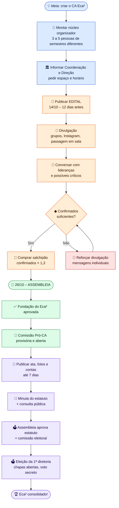
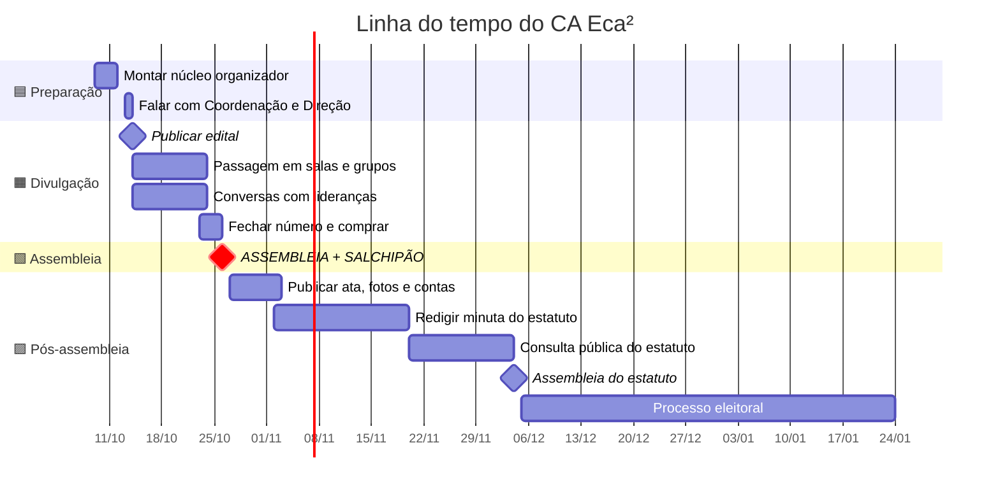
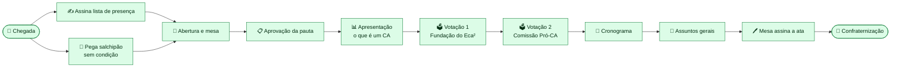
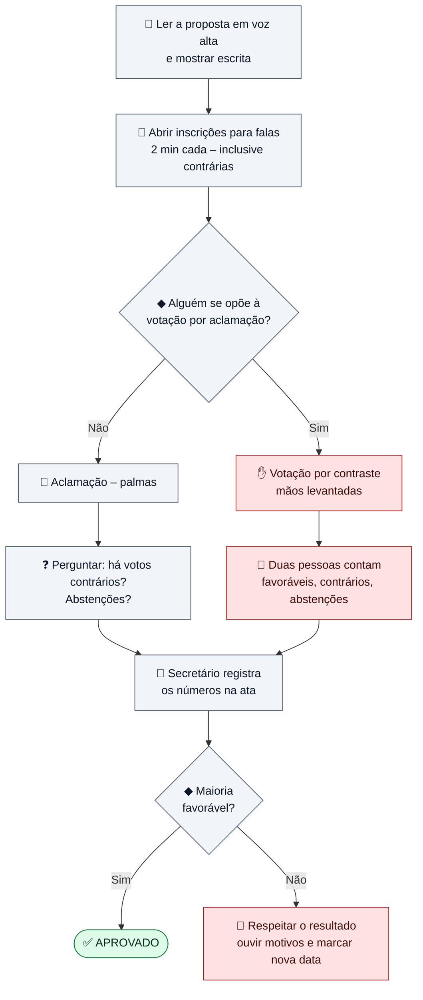
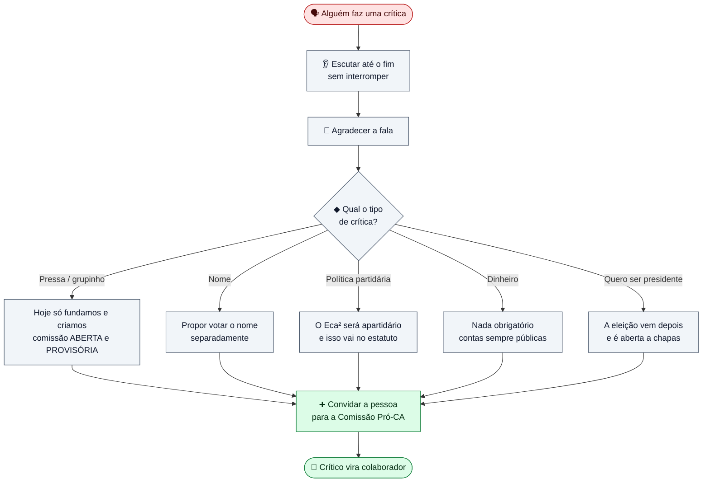
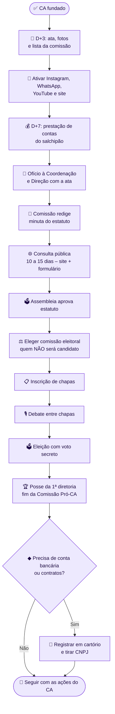

# 🗺️ Fluxograma Didático – Fundação do CA Eca²
*Como ler: siga as setas de cima para baixo. Cada cor é uma fase. Losangos (◆) são decisões.*

| Cor | Fase |
|-----|------|
| 🟦 Azul | Preparação |
| 🟧 Laranja | Divulgação |
| 🟩 Verde | O dia da assembleia |
| 🟪 Roxo | Pós-assembleia |
| 🟥 Vermelho | Plano B / atenção |

---

## 1. Visão geral – do zero até a primeira diretoria

---

## 2. Linha do tempo (calendário)

> ⚠️ As datas pós-assembleia são **indicativas** e devem ser ajustadas ao calendário acadêmico da UERGS (férias de verão).

---

## 3. O dia da assembleia – passo a passo

**⏱️ Tempo total da assembleia: até 45 minutos.**

---

## 4. Como votar sem dar margem para contestação

> 💡 **Votação contada não é derrota.** Ela deixa o resultado ainda mais forte.

---

## 5. Como lidar com uma crítica

---

## 6. Depois da assembleia – até a eleição

---

## 📌 Resumo em uma frase
> **Avisar todo mundo antes → fundar com transparência → abrir a porta para todos → eleger com regras claras.**
