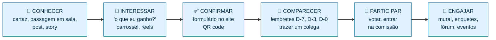
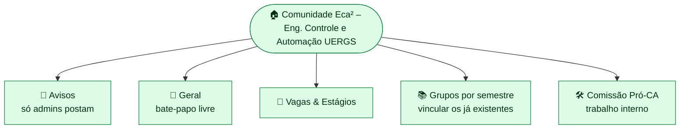

# 📣 Estratégia de Atração de Alunos e Redes Sociais – CA Eca²
*Canais escolhidos: **Instagram · Comunidade WhatsApp · YouTube · Site do Eca²***

---

## 1. Conhecendo o público

O curso é **vespertino/noturno (17h–22h30)** na Unidade de Porto Alegre. Isso muda tudo:

| Perfil | Característica | Como atrair |
|--------|----------------|-------------|
| 🧑‍🎓 **Calouro** | Não conhece ninguém, quer se enturmar | Acolhimento, "guia de sobrevivência", grupo da turma |
| 🧑‍🔧 **Meio do curso** | Quer estágio, laboratório, matérias melhores | Vagas, banco de provas, voz junto à coordenação |
| 👷 **Trabalha de dia** | **Pouco tempo**, chega em cima da hora | Assembleia curta, no intervalo, conteúdo rápido no WhatsApp |
| 🎓 **Formando** | Foco em TCC e estágio | Networking com egressos, vagas, palestras |

> 💡 **Regra principal:** o tempo do aluno é escasso. Tudo deve ser **curto, útil e no celular**.

---

## 2. A pergunta que todo aluno faz: *"O que eu ganho com isso?"*

Toda divulgação deve responder isso. Mensagens-chave:

- 🗣️ **Voz:** "Hoje ninguém fala pelo curso. Com o CA, a gente fala junto com a coordenação."
- 💼 **Carreira:** vagas de estágio, visitas técnicas, palestras com a indústria.
- 📚 **Estudo:** banco de provas, monitoria, grupos de estudo.
- 🤝 **Comunidade:** recepção de calouros, eventos, confraternizações.
- 🌭 **E no dia 26:** salchipão para todos!

### Slogans (identidade "engenharia de controle")
- **"Sem feedback não há controle."** ← principal
- "Fechando a malha do nosso curso."
- "Controle e automação ao quadrado: Eca²."
- "Setpoint: um curso melhor. Controlador: todos nós."

---

## 3. O funil de atração



**Meta de conversão:** cada etapa perde gente. Por isso o contato **pessoal** (passagem em sala + mensagem individual) é o que mais converte.

---

## 4. Táticas presenciais (as mais eficazes)

| Tática | Como fazer | Responsável |
|--------|-----------|-------------|
| 🎯 **Embaixadores por turma** | 1 pessoa por semestre que repassa avisos e traz a turma. Reconhecer publicamente no Instagram | Coordenação geral |
| 🗣️ **Passagem em sala** | 90 segundos, com permissão do professor, em **100% das turmas** (roteiro no arquivo 07) | Comunicação |
| 📌 **Cartazes com QR code** | Mural, porta das salas, laboratórios, cantina | Comunicação |
| 🪑 **Banquinha no intervalo** | Mesa com cartaz, QR code e conversa nos dias 20–23/10 | Núcleo |
| 👫 **"Traz um colega"** | Pedir a cada confirmado que traga mais uma pessoa | Todos |
| 👨‍🏫 **Professores aliados** | Pedir aviso em aula, Moodle ou e-mail da coordenação | Coordenação geral |
| 🤖 **Grupos existentes** | Equipes de robótica, empresa júnior, monitores, grupos de pesquisa | Núcleo |

---

## 5. 📸 Instagram – vitrine principal

### Configuração
- **Usuário:** `@eca2.uergs` (alternativas: `@eca2uergs`, `@ca.eca2`)
- **Nome:** `Eca² · CA Eng. Controle e Automação UERGS`
- **Bio:**
  ```
  ⚙️ Centro Acadêmico de Eng. de Controle e Automação – UERGS POA
  🔁 Sem feedback não há controle
  🗳️ Fundação: 26/10 + 🌭 salchipão
  👇 Confirma presença, mural e fórum
  ```
- **Link na bio:** o **site do Eca²** (ele concentra tudo).
- **Foto de perfil:** logo Eca² (fundo escuro, ciano e laranja, igual ao site).

### Destaques (stories fixos)
`📌 Sobre` · `🗳️ Fundação` · `📊 Transparência` · `🎓 O Curso` · `📅 Eventos` · `❓ FAQ`

### Formatos e quando usar
| Formato | Uso | Exemplo |
|---------|-----|---------|
| **Carrossel** | Explicar | "5 coisas que um CA faz por você" |
| **Reels (15–30 s)** | Alcançar quem não segue | "POV: teu curso não tem CA" · bastidores do salchipão |
| **Stories com enquete** | Engajar e ouvir | "Qual a maior dor do curso? 🅰️ Laboratório 🅱️ Horários" |
| **Caixinha de perguntas** | Tirar dúvidas | "Pergunte qualquer coisa sobre o CA" |
| **Contagem regressiva** | Lembrar do evento | Sticker de contagem para 26/10 |
| **Collab** | Alcance cruzado | Post em colaboração com DCE ou perfil oficial da UERGS |

### Melhores horários
Aulas das 17h às 22h30 → postar às **12h–13h** (almoço) e **22h40** (saída da aula).

### Tom de voz
Descontraído, inclusivo, com piadas de engenharia (PID, malha fechada, CLP…), **nunca** ofensivo, **sempre apartidário**.

---

## 6. 💬 Comunidade WhatsApp – canal de ação

É onde o aluno realmente **lê**. Estrutura sugerida:



### Regras da comunidade (fixar na descrição)
1. Respeito sempre; sem ofensas ou discriminação.
2. Sem propaganda político-partidária.
3. Sem spam ou correntes.
4. Vagas e eventos no grupo certo.
5. Dúvidas sobre o CA? Pergunte! Toda dúvida é bem-vinda.

### Boas práticas
- No grupo de Avisos, **no máximo 1 mensagem por dia** (senão silenciam).
- Mensagens curtas, com emoji no início e link no final.
- Moderação: pelo menos 2 admins de semestres diferentes.

---

## 7. ▶️ YouTube – memória e conteúdo de valor

O YouTube não é para divulgação rápida, e sim para **conteúdo duradouro** e **transparência**.

| Playlist | Conteúdo |
|----------|----------|
| 🎬 **Shorts** | Reaproveitar os Reels do Instagram (custo zero) |
| 🏛️ **Por dentro do curso** | Tour pelos laboratórios, entrevistas com professores e egressos |
| 🎤 **Palestras e eventos** | Gravações de palestras e semana acadêmica |
| 🧠 **Tutoriais** | CLP, Arduino, MATLAB/Simulink, Python para controle – feitos por alunos |
| 🗳️ **Transparência** | Resumo das assembleias (sempre com aviso e consentimento de imagem) |

- **Canal:** `@eca2uergs`
- **Primeiro vídeo (D+3):** "Fundamos o CA! Resumo da assembleia do Eca²" (2–3 min).

---

## 8. 🌐 Site do Eca² – o centro de tudo

Todos os canais apontam para o site, que oferece:
- ✅ Confirmação de presença na assembleia
- 💡 **Mural de sugestões** com votos
- 📊 **Enquetes**
- 💬 **Fórum** de dúvidas e discussões
- 🎓 Informações sobre o curso
- 📅 Agenda e 📄 transparência (ata, contas, estatuto)

---

## 9. 📅 Calendário de conteúdo

### Antes da assembleia
| Data | Instagram | WhatsApp | Presencial |
|------|-----------|----------|------------|
| **13/10** ter | Criar perfil, 3 posts fixados: *O que é o Eca²* · *Por que um CA* · *26/10* | – | Coordenação |
| **14/10** qua | 📄 Post do **edital** + story com link | Lançamento (msg 1) | Cartazes |
| **15/10** qui | Carrossel: *5 coisas que um CA faz por você* | – | Passagem em sala |
| **16/10** sex | Story: enquete *"Qual a maior dor do curso?"* | – | Passagem em sala |
| **19/10** seg | Reels: *POV: teu curso não tem CA* | Lembrete (msg 2) | Passagem em sala |
| **20/10** ter | Carrossel: *Como vai ser a assembleia (40 min!)* | – | Banquinha |
| **21/10** qua | Post: *Conheça os embaixadores das turmas* | – | Banquinha |
| **22/10** qui | Story: caixinha de perguntas + respostas | – | Banquinha |
| **23/10** sex | Reels: *Bastidores – preparando o salchipão* 🌭 | Último aviso (msg 3) | Banquinha |
| **25/10** dom | Story: contagem regressiva | – | – |
| **26/10** seg | Stories **ao vivo** do evento | "É HOJE" | 🎉 |

### Depois da assembleia
| Data | Ação |
|------|------|
| **27/10** | Carrossel com fotos: *"Nasceu o Eca²!"* + agradecimento |
| **29/10** | Ata publicada no site + post *"Transparência: leia a ata"* |
| **29/10** | Vídeo-resumo no YouTube |
| **02/11** | Prestação de contas do salchipão (post + site) |
| **Semanal** | Série *"Conheça a Comissão Pró-CA"* (1 integrante por semana) |
| **Semanal** | Enquete no site e no story (ex.: tema da 1ª palestra) |
| **~20/11** | Campanha **consulta pública do estatuto** – *"Dê sua opinião"* |
| **Dez/26** | Campanha da **eleição** – regras, chapas, debate, votação |
| **Mar/27** | **Recepção de calouros** – maior oportunidade de crescimento |

---

## 10. 🛡️ Regras de ouro da comunicação (para não criar opositores)

1. **Apartidário sempre.** Nenhum post com posicionamento político-partidário.
2. **Nunca expor ou ironizar ninguém**, nem críticos.
3. **Críticas públicas** → responder com educação e convidar para a conversa. Nunca apagar crítica respeitosa.
4. **Consentimento de imagem**: avisar antes de fotografar e retirar fotos a pedido.
5. **LGPD**: não divulgar lista de presença, matrículas ou contatos.
6. **Transparência**: tudo que for decidido ou gasto vai para o site.
7. **Crédito**: agradecer publicamente quem ajuda (embaixadores, professores, voluntários).

---

## 11. 📊 Métricas e metas

| Indicador | Meta até 26/10 | Onde medir |
|-----------|---------------|------------|
| Turmas visitadas | **100%** | [06_Controle_Turmas.csv](06_Controle_Turmas.csv) |
| Embaixadores | **1 por semestre** | Planilha |
| Confirmações no site | **≥ 50% dos alunos ativos** | Painel do site |
| Presentes na assembleia | **≥ 30% dos alunos ativos** | Lista de presença |
| Seguidores no Instagram | ≥ número de alunos do curso | Instagram |
| Membros na Comunidade WhatsApp | ≥ 70% dos alunos | WhatsApp |
| Inscritos na Comissão Pró-CA | ≥ 8 pessoas, de ≥ 4 semestres | Ficha de inscrição |

---

## 12. 🧰 Ferramentas gratuitas
| Para | Ferramenta |
|------|-----------|
| Artes e carrosséis | Canva (plano educação gratuito) |
| Vídeos curtos | CapCut |
| QR codes | Gerador do Canva ou qr-code-generator.com |
| Agendar posts | Meta Business Suite (gratuito) |
| Formulários | Site do Eca² ou Google Forms |
