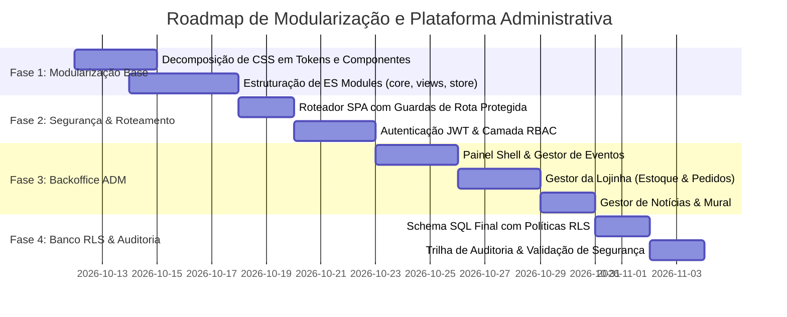

# 🏛️ Plano de Arquitetura & Implementação: Modularização e Plataforma ADM E(CA)²

> **Documento de Engenharia de Software & Segurança**  
> **Papel:** Staff / Lead Software Architect  
> **Status:** Proposta & Roadmap de Execução  
> **Escopo:** Modularização do Frontend, Painel Administrativo Integrado e Segurança Zero Trust.

---

## 1. Visão Geral & Objetivos Estratégicos

O portal do **E(CA)²** atingiu o estágio em que precisa deixar de ser um site estático/semi-estático para se tornar uma **Plataforma Acadêmica Operacional Completa**. 

### Requisitos Principais:
1. **Modularização Extrema:** Decompor os monólitos atuais (`app.js` de ~4.400 linhas e `styles.css` de ~2.260 linhas) em arquitetura desacoplada baseada em componentes e módulos coesos (ES Modules nativos).
2. **Plataforma Administrativa Unificada (Backoffice do CA):**
   * **Gestão de Eventos:** Criação, edição, datas, horários, RSVP, anexos e sincronização automática com o calendário mensal.
   * **Gestão da Lojinha:** Catálogo de vestuário e utensílios, controle de estoque, controle de pedidos/encomendas, precificação e ativação/desativação de itens.
   * **Gestão de Notícias & Comunicação:** Publicação de editais, comunicados oficiais, notícias de interesse estudantil e moderação do Mural acadêmico.
   * **Governança & Assembleia:** Gestão de alunos aptos com e-mail institucional `@uergs.edu.br`, registro de presenças e relatórios de votação.
3. **Segurança Corporativa (Security-by-Design & Zero Trust):**
   * Princípio do menor privilégio (*Least Privilege*).
   * Controle de Acesso Baseado em Papéis (*RBAC*).
   * Blindagem em dupla camada (Validação Client-Side na UI + Row Level Security - RLS inquebrável no banco).
   * Proteção contra o **OWASP Top 10** (XSS, CSRF, Injeção, Broken Access Control, Quebra de Sessão).

---

## 2. Diagnóstico da Situação Atual (As-Is) vs. Alvo (To-Be)

| Dimensão | Situação Atual (As-Is) | Arquitetura Alvo (To-Be) |
| :--- | :--- | :--- |
| **Código JS** | Monólito em `app.js` misturando roteamento, lógica de negócio, templates HTML e persistência. | Arquitetura Modular (ES Modules): `core/`, `views/`, `admin/`, `components/` e `services/`. |
| **Estilos CSS** | Arquivo único `styles.css` com escopo global e alta propensão a conflitos de seletores. | CSS Modular organizado em Design Tokens, componentes isolados e folhas de visão/admin. |
| **Administração** | Feita via manipulação direta de arquivos JS/JSON ou console do navegador. | Painel Administrativo Protegido (`#admin`) com autenticação, formulários validados e previews em tempo real. |
| **Segurança & Permissões** | Verificação simplificada no frontend com flags no LocalStorage. | Autenticação JWT com validação criptográfica e políticas estritas de RLS no PostgreSQL (Supabase). |
| **Auditoria** | Sem histórico de quem fez alterações nos dados. | Tabela imutável de `audit_logs` rastreando usuário, timestamp, ação e *diff* de dados. |

---

## 3. Nova Estrutura de Diretórios (Modularização)

```text
site/
├── index.html                   # Shell da aplicação (carrega tokens e loader principal)
├── css/
│   ├── tokens.css               # Cores, tipografia industrial, raios, sombras, variáveis base
│   ├── reset.css                # Normalização e resets de layout
│   ├── components.css           # Botões, cards, badges, modais, formulários, alertas
│   ├── admin.css                # Layout do dashboard, tabelas de dados, painéis de gestão
│   └── views/                   # Estilos específicos de cada tela
│       ├── inicio.css
│       ├── curso.css
│       ├── eventos.css
│       ├── lojinha.css
│       └── mural.css
├── js/
│   ├── main.js                  # Entrypoint: Inicializa roteador, autenticação e layout
│   ├── config.js                # Constantes, endpoints de API e configurações de ambiente
│   ├── core/                    # Núcleo da arquitetura
│   │   ├── router.js            # Roteador SPA com suporte a rotas públicas e rotas protegidas
│   │   ├── auth.js              # Gerenciamento de sessão, login institucional e estado do usuário
│   │   ├── rbac.js              # Definição e checagem de permissões e papéis
│   │   ├── security.js          # Sanitização anti-XSS, validação de tipos e CSRF mitigation
│   │   └── store.js             # Camada de abstração de dados (Supabase SDK + Fallback seguro)
│   ├── components/              # Componentes de UI reutilizáveis
│   │   ├── modal.js             # Gerenciamento de janelas e dialogs acessíveis
│   │   ├── toast.js             # Notificações visuais de feedback operacional
│   │   ├── calendar-widget.js   # Calendário mensal interativo
│   │   ├── data-table.js        # Tabelas dinâmicas com paginação, busca e ordenação
│   │   └── countdown.js         # Contagem regressiva de eventos
│   ├── views/                   # Controladores das páginas públicas
│   │   ├── inicio.js            # Home, malha de controle, destaques
│   │   ├── curso.js             # Matrizes PPC 2019/2024, perfil profissional, CREA
│   │   ├── eventos.js           # Agenda acadêmica e calendário
│   │   ├── lojinha.js           # Catálogo público da loja e carrinho/pedidos
│   │   ├── mural.js             # Fórum, oportunidades e sugestões
│   │   └── urna.js              # Assembleia, eleição pró-CA e votação
│   └── admin/                   # Módulos exclusivos da Área Administrativa
│       ├── admin-shell.js       # Layout mestre do painel, sidebar e guardas de rota
│       ├── admin-eventos.js     # CRUD de eventos e presenças
│       ├── admin-loja.js        # Gestão de produtos, pedidos e estoque
│       ├── admin-noticias.js    # Editor de comunicados, editais e moderação
│       ├── admin-alunos.js      # Gestão de matrículas aptas e permissões
│       └── admin-logs.js        # Visualizador de auditoria e métricas
```

---

## 4. Engenharia de Segurança & Princípios Zero Trust

### 4.1. Matriz de Controle de Acesso (RBAC)

Definição formal de três níveis de privilégios:

| Operação | Visitante (`public`) | Estudante UERGS (`student`) | Gestão CA (`ca_manager`) | Administrador Geral (`super_admin`) |
| :--- | :---: | :---: | :---: | :---: |
| Ver site, matrizes, calendário | ✅ | ✅ | ✅ | ✅ |
| Votar na urna / Assinar lista | ❌ | ✅ (com validação @uergs) | ✅ | ✅ |
| Sugerir no Mural / RSVP | ❌ | ✅ | ✅ | ✅ |
| Adicionar / Editar Eventos | ❌ | ❌ | ✅ | ✅ |
| Gerenciar Lojinha & Pedidos | ❌ | ❌ | ✅ | ✅ |
| Publicar Notícias & Avisos | ❌ | ❌ | ✅ | ✅ |
| Conceder permissões de Gestão | ❌ | ❌ | ❌ | ✅ |
| Consultar Logs de Auditoria | ❌ | ❌ | ❌ | ✅ |

### 4.2. Segurança em Nível de Linha (PostgreSQL RLS)
Mesmo que um invasor burle a interface no navegador, as chamadas para o banco de dados falharão na origem com erro `403 Forbidden`:

```sql
-- Exemplo de política RLS para Eventos
alter table public.events enable row level security;

-- Leitura pública para todos os alunos
create policy "eventos_leitura_publica" 
  on public.events for select 
  using (true);

-- Escrita restrita a membros autenticados da gestão do CA
create policy "eventos_escrita_apenas_gestao" 
  on public.events for insert 
  with check (
    exists (
      select 1 from public.admin_roles 
      where user_id = auth.uid() 
      and role in ('ca_manager', 'super_admin')
    )
  );
```

### 4.3. Prevenção Contra Injeção e Cross-Site Scripting (XSS)
* **Sanitização de Entradas de Texto:** Todo conteúdo inserido em formulários de notícias ou eventos passa por sanitização estrita (removendo tags `<script>`, manipuladores `onload`/`onerror`, atributos perigosos e iframes não autorizados).
* **Escape Seguro na Renderização:** Uso estrito de manipulação de nós de texto (`textContent`) e templates higienizados, evitando `innerHTML` cego com dados de terceiros.
* **Content Security Policy (CSP):** Adição de cabeçalhos estritos que bloqueiam execução de códigos inline maliciosos e limitam origens permitidas de scripts externos.

### 4.4. Trilha de Auditoria Imutável (Audit Trail)
Toda mutação crítica (`CRIAR_EVENTO`, `EDITAR_PRODUTO`, `DELETAR_NOTICIA`, `AUTORIZAR_ALUNO`) gera um registro automático no PostgreSQL:
```sql
create table public.audit_logs (
  id uuid primary key default gen_random_uuid(),
  actor_id uuid references auth.users(id),
  action text not null,
  target_entity text not null,
  target_id text,
  payload_diff jsonb,
  ip_address text,
  created_at timestamptz default now() not null
);
```

---

## 5. Roadmap de Implementação em 4 Fases



### Fase 1: Modularização da Base Atual (Sem Quebra de Funcionalidades)
1. Criar `site/css/tokens.css` e fragmentar `styles.css` mantendo 100% de retrocompatibilidade visual.
2. Dividir `app.js` em módulos atômicos dentro de `site/js/views/` e `site/js/core/`.
3. Manter o modo híbrido (funciona 100% localmente com dados de demonstração e sincroniza quando conectado ao backend).

### Fase 2: Motor de Segurança & Roteador Protegido
1. Implementar `router.js` com interceptador de rotas:
   * Rotas públicas: `#inicio`, `#curso`, `#eventos`, `#shop`, `#mural`, `#urna`.
   * Rotas administrativas: `#admin`, `#admin/eventos`, `#admin/loja`, `#admin/noticias`, `#admin/alunos`.
2. Se o usuário tentar acessar `#admin` sem credenciais ativas de gestor, a aplicação redireciona automaticamente para um formulário de login seguro e exibe alerta amigável.

### Fase 3: Desenvolvimento dos Módulos do Painel ADM
1. **Painel de Eventos:**
   * Formulário intuitivo para agendar evento (Título, Categoria, Data/Hora, Local, Vagas, Link de RSVP e Destaque no Calendário).
   * Visualização da lista de inscritos/confirmados para o Salchipão e visitas técnicas.
2. **Painel da Lojinha:**
   * Cadastro de novos itens com fotos, descrições, preços e variações (ex: tamanhos P, M, G, GG).
   * Contador de estoque e botão de troca de status rápida (Ativo / Pré-venda / Esgotado).
   * Gerenciamento de pedidos com mudança de status (Aguardando / Pago / Entregue).
3. **Painel de Notícias & Mural:**
   * Publicação de comunicados com data de validade (avisos que somem após determinada data).
   * Moderação com 1 clique (aprovar, ocultar ou responder sugestões enviadas por estudantes).

### Fase 4: Integração de Banco de Dados, RLS & Auditoria
1. Aplicação do script consolidado no PostgreSQL com Row Level Security.
2. Ativação de Triggers de auditoria imutáveis.
3. Teste de invasão (pentest) simulando acessos não autorizados para comprovar que nenhuma alteração indevida é permitida.
